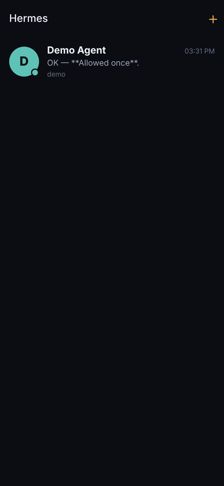
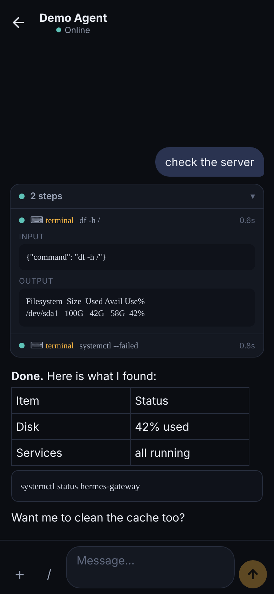
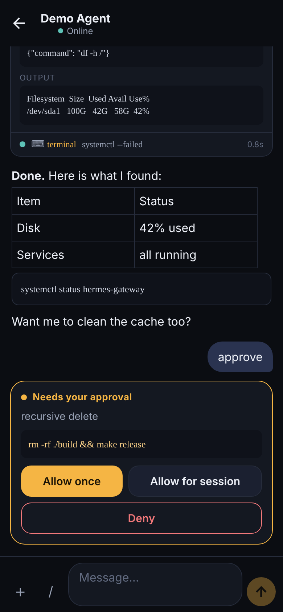

# Hermes Mobile

تطبيق جوال خاص (iPhone و Android) تتواصل منه مع الـ Agents في [Hermes Agent](https://github.com/NousResearch/hermes-agent)، بدون واتساب أو تيليقرام أو أي خدمة طرف ثالث.

A private iOS + Android app for chatting with your Hermes Agent profiles. No WhatsApp, Telegram or other third-party service: the phone talks straight to your own Hermes.

| Chats | Tool steps (collapsed → expanded) | Approval buttons |
|---|---|---|
|  |  |  |

## What you get

* **One chat per Hermes profile.** Every profile you pair shows up as its own conversation, with live status.
* **Real buttons.** Dangerous-command approvals, the agent's multiple-choice questions, and slash-command confirmations are tappable cards. No typing `/approve`.
* **Clean answers.** Markdown, tables and code render properly. Tool calls (terminal commands, file edits, searches…) are folded into a "N steps" line you can open to see each command and its output.
* **Streaming** answers, typing indicator, photos/files both ways, quick commands (`/new`, `/stop`, `/retry`, `/model`).
* **Push notifications** when an answer or an approval arrives while the app is closed.
* **Sharing.** Give a friend access to *one* profile only: they get their own private chat on it and nothing else. Revoke any time. Friends with their own Hermes just install the bridge on their machine and pair their phone.

## How it works

```
 Phone app  ── WebSocket (token per phone) ──►  hermes_mobile plugin  ──►  Hermes gateway (one per profile)
```

* `bridge/hermes_mobile/` is a **Hermes platform plugin** (the same kind of adapter Hermes uses for Telegram), so Hermes treats the app as a first-class channel: sessions, approvals, clarify questions, tool hooks.
* `app/` is the **React Native (Expo SDK 58)** app.
* `docs/protocol.md` describes the wire protocol.

## Setup

### 1. On the Hermes machine

```bash
git clone https://github.com/LTF92/Assaf.git && cd Assaf/bridge
./install.sh                    # default profile on port 8765
./install.sh coder 8766         # another profile: one port per profile
```

The script copies the plugin to `~/.hermes/plugins/hermes_mobile`, enables it, turns the channel on in the profile's `.env` (`HERMES_MOBILE_ENABLED`, `HERMES_MOBILE_PORT`, `HERMES_MOBILE_ALLOW_ALL_USERS`), enables streaming, switches emoji progress bubbles off for this channel (the app shows tool cards instead) and restarts the gateway.

> `HERMES_MOBILE_ALLOW_ALL_USERS=true` only opens Hermes' user allowlist **for this channel**; nobody reaches it without a paired token.

**Reaching it from outside your home:** install [Tailscale](https://tailscale.com) on the Hermes machine and on your phone. The pairing command picks your Tailscale IP automatically. Do not expose the port to the internet directly; if you use a reverse proxy or Cloudflare Tunnel, pair with `--url wss://your-host`.

### 2. Pair your phone

```bash
hermes mobile pair --name "My iPhone"              # or: python3 ~/.hermes/plugins/hermes_mobile/pair.py pair
hermes -p coder mobile pair --name "My iPhone"     # each profile you want on the phone
```

Scan the QR code from the app (**＋ → Scan QR code**), or paste the `hermesmobile://` link.

### 3. Give someone one profile

From the app: open the chat → tap the title → **Share this profile** → enter their name → they scan the QR.
Or from the machine: `python3 ~/.hermes/plugins/hermes_mobile/pair.py -p coder pair --guest --name "Ahmed"`.
Their phone must be able to reach your machine (e.g. share the machine with them in Tailscale).

List and revoke devices: in the app (same screen) or `pair.py -p coder list` / `revoke <id>`.

### 4. Run the app

```bash
cd app
npm install
npx expo start          # scan with Expo Go to try it
```

Expo Go is enough for chatting. **Push notifications need a development build** (Expo Go on Android no longer supports remote push):

```bash
npx eas-cli@latest init          # adds the EAS projectId used for push
npx eas-cli@latest build --profile development --platform ios     # or android
```

### Try the app without Hermes

```bash
pip install websockets qrcode
python3 bridge/dev_server.py          # prints a QR code for a fake agent
```

Send `approve`, `ask` or `file` to see the cards.

## Development

```bash
# bridge (Python, no Hermes needed)
cd bridge && pip install websockets pytest pytest-asyncio && python -m pytest

# app
cd app && npx tsc --noEmit && npm run test:integration   # drives the real client against dev_server.py
```

## Security notes

* Each phone has its own random token; the machine stores only its SHA-256 (`<profile>/mobile/devices.json`, mode 600). Tokens on the phone live in the iOS Keychain / Android Keystore.
* Guests only ever see their own chat; media downloads are checked against the requesting device's chat.
* Revoking a device cuts its live connection immediately.
* Traffic is plain `ws://` inside Tailscale (which is already encrypted end to end). Use `wss://` behind a TLS proxy for anything else.
